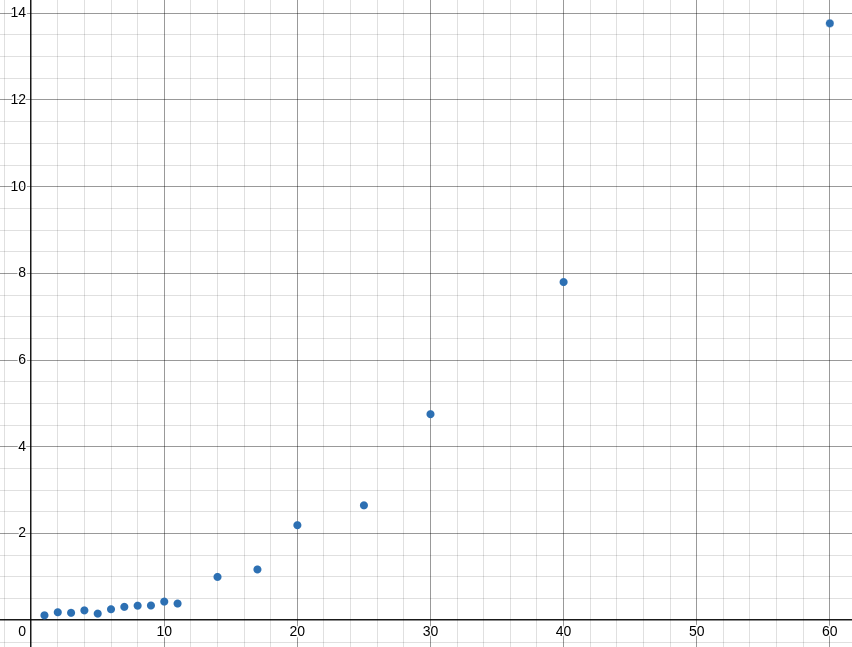
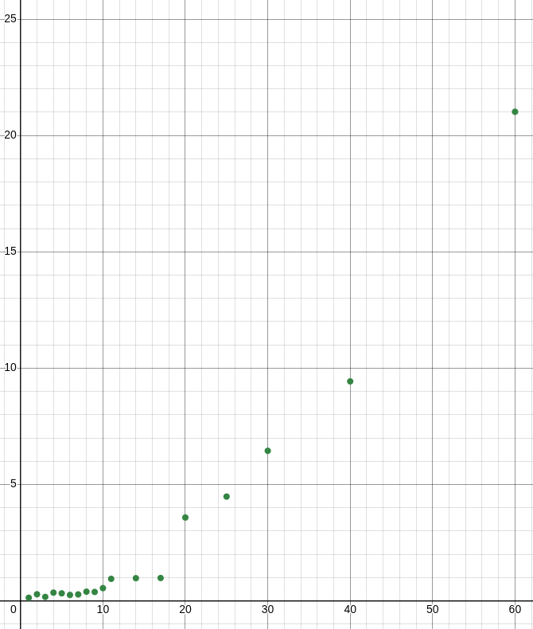
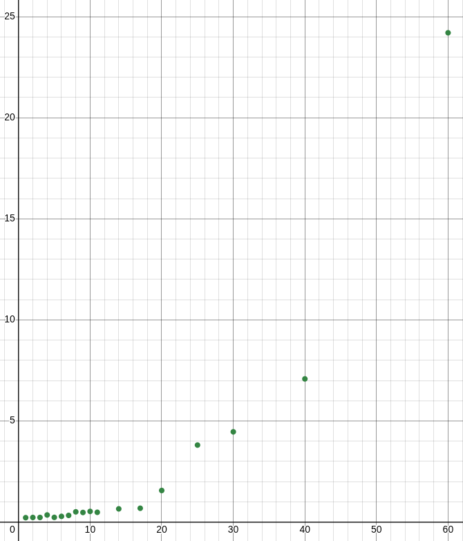

# HWMN

| Mat size | Recursion, ms | Gauss, ms | Bareiss, ms | LU, ms |
| :------: | :-----------: | :-------: | :---------: | :----: |
| 1        | 0.074 | 0.190 | 0.131 | 0.216 |
| 2        | 0.076 | 0.186 | 0.281 | 0.226 |
| 3        | 0.209 | 0.173 | 0.167 | 0.194 |
| 4        | 0.209 | 0.229 | 0.352 | 0.350 |
| 5        | 0.243 | 0.155 | 0.321 | 0.231 |
| 6        | 0.297 | 0.256 | 0.253 | 0.281 |
| 7        | 0.748 | 0.311 | 0.275 | 0.328 |
| 8        | 4.040 | 0.338 | 0.392 | 0.505 |
| 9        | 27.84 | 0.342 | 0.381 | 0.473 |
| 10       | 90.87 | 0.432 | 0.545 | 0.482 |
| 11       | 812.0 | 0.387 | 0.944 | 0.526 |
| 14       | 7868  | 1.001 | 0.973 | 0.652 |
| 17       | 83834 | 1.173 | 0.980 | 0.682 |
| 20       |       | 2.194 | 3.580 | 1.561 |
| 25       |       | 2.652 | 4.480 | 3.808 |
| 30       |       | 4.754 | 6.447 | 4.463 |
| 40       |       | 7.801 | 9.432 | 7.081 |
| 60       |       | 13.77 | 21.02 | 24.20 |

# Gauss

# Bareiss

# LU

